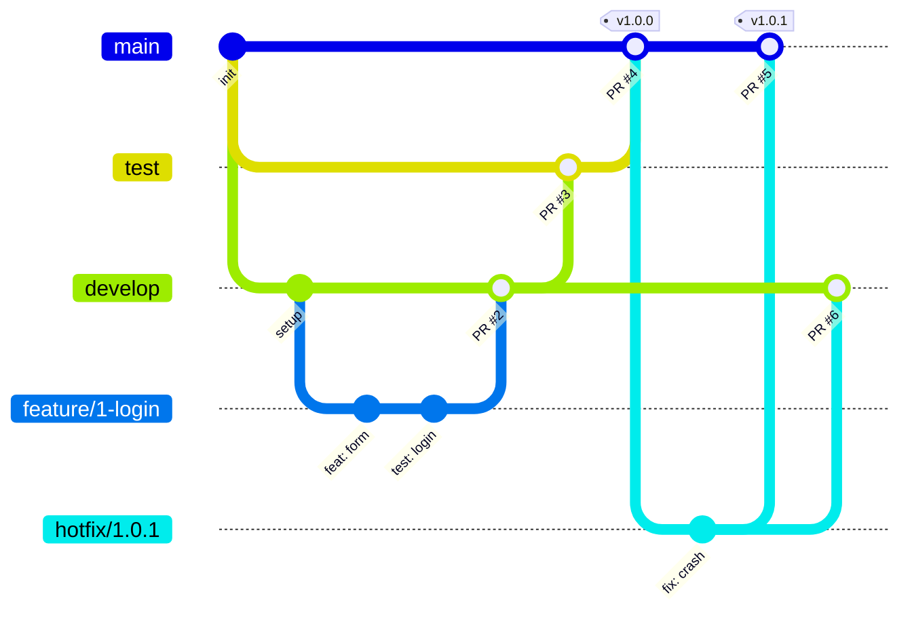

# Juego de Adivinar el Número


Juego web y de consola para adivinar un número secreto.

## Tabla de contenido
- [Tecnologías](#tecnologías)
- [Requisitos](#requisitos)
- [Instalación](#instalación)
- [Uso con Docker](#uso-con-docker)
- [Pruebas](#pruebas)
- [Flujo de ramas](#flujo-de-ramas)
- [CI/CD](#cicd)
- [Despliegues](#despliegues)
- [Licencia](#licencia)

## Tecnologías
Python 3.12, Flask, Docker, GitHub Actions.

## Requisitos
- Docker 27+ y Docker Compose
- (Opcional) Python 3.12 para desarrollo local

## Instalación
```bash
git clone git@github.com:HelberthGM/gestor-tareas.git
cd gestor-tareas
cp .env.example .env
```

### Entorno virtual

Crear y activar el entorno virtual antes de instalar las dependencias:

```bash
python3 -m venv .venv
source .venv/bin/activate
python -m pip install --upgrade pip
pip install -e ".[dev]"
```

En Windows PowerShell, activa el entorno con:

```powershell
python -m venv .venv
.venv\Scripts\Activate.ps1
python -m pip install --upgrade pip
pip install -e ".[dev]"
```

## Uso con Docker
```bash
docker compose up -d --build
# Abrir http://localhost:8000
```

### Docker local

Copia las variables de ejemplo y arranca la aplicación construida localmente:

```bash
cp .env.example .env
docker compose up --build
```

La aplicación escucha en `0.0.0.0`, usa `PORT` y expone:

- `GET /health`: estado de la aplicación.
- `GET /version`: versión y commit.

Para producción con una imagen publicada en GHCR:

```bash
IMAGE=ghcr.io/tu-usuario/gestor-tareas \
TAG=1.2.0 \
SECRET_KEY="clave-segura" \
APP_COMMIT="$(git rev-parse HEAD)" \
docker compose -f compose.prod.yaml up -d
```

`compose.prod.yaml` no construye imágenes: usa `IMAGE` y `TAG` proporcionados por
el pipeline. Nunca escribas secretos en el Dockerfile, Compose ni `.env` de Git.

### Interfaz web

```bash
pip install -e .
flask --app juego_numero.app run
# Abrir http://127.0.0.1:5000
```

La interfaz permite configurar el rango numerico, enviar intentos, ver pistas,
conocer el total de intentos y comenzar otra partida sin recargar la pagina.

### Consola

La funcionalidad de consola se mantiene disponible después de instalar el proyecto:

```bash
pip install -e .
juego-numero
```

También puedes ejecutar la consola directamente:

```bash
python -m juego_numero
```

Opciones disponibles:

```bash
juego-numero --minimo 1 --maximo 50 --intentos 5
```

## Pruebas
```bash
# Todas las pruebas unitarias y web
pytest -m "not integration"

# Prueba de integración con Docker Compose
pytest -m integration -v

# Todas las pruebas
pytest
```

La integración Docker construye el contenedor, levanta la aplicación en el puerto
`18081`, valida `/`, `/health`, `/version` y una operación de juego. Al finalizar,
Compose detiene y elimina sus recursos. Requiere Docker con Compose disponible.

## Flujo de ramas
`feature/*` → `develop` → `test` → `main`. Hotfix: `hotfix/*` → `main` y `develop`.


## CI/CD

- `ci.yml` ejecuta lint y pruebas unitarias/web en Python 3.10, 3.12 y 3.13.
- `ci.yml` también ejecuta la prueba de integración con Docker Compose.
- `docker.yaml` prueba y publica la imagen en GHCR cuando se crea un tag `v*`.
- Las imágenes reciben además el tag `latest` y el tag semántico correspondiente.

## Despliegues
- Producción (Render): https://<app>.onrender.com
- Servidor propio: http://localhost:8000 (actualizado automáticamente desde `main`)

## Autor
Nombre - [@HelberthGM](https://github.com/HelberthGM)

## Licencia
Distribuido bajo la licencia GPL-3.0. Ver `LICENSE`.
